<div align="center">

# 🛡️ Cyber360

### Plateforme EASM & Cyber Threat Intelligence pour les organisations marocaines

*Cartographier la surface d'attaque externe, corréler les failles en chemins d'attaque réels, et traduire le tout en conformité (DNSSI, Loi 09-08, ISO 27001).*

[](https://fastapi.tiangolo.com/)
[](https://react.dev/)
[](https://www.typescriptlang.org/)
[](https://www.postgresql.org/)
[](https://docs.celeryq.dev/)
[](https://redis.io/)
[](https://www.docker.com/)
[](https://attack.mitre.org/)

<br>

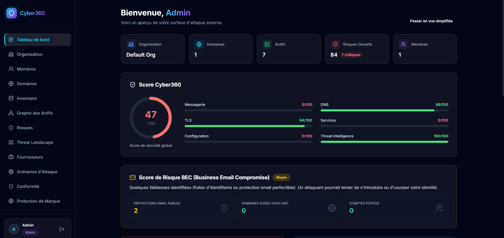

</div>

---

## 📑 Sommaire

- [Pourquoi Cyber360 ?](#-pourquoi-cyber360-)
- [Fonctionnalités](#-fonctionnalités)
- [Architecture](#️-architecture)
- [Ce qui rend le moteur de corrélation différent](#-ce-qui-rend-le-moteur-de-corrélation-différent)
- [Stack technique](#-stack-technique)
- [Démarrage rapide](#-démarrage-rapide)
- [Configuration](#️-configuration)
- [Tests](#-tests)
- [Structure du dépôt](#-structure-du-dépôt)
- [Limites connues et feuille de route](#-limites-connues-et-feuille-de-route)
- [Cadre légal et déontologique](#️-cadre-légal-et-déontologique)

---

## 🎯 Pourquoi Cyber360 ?

Une organisation moyenne ne connaît pas l'ensemble de ce qu'elle expose sur Internet : sous-domaines oubliés, serveurs de test, certificats non suivis. C'est le **Shadow IT**. Les scanners classiques y répondent par une liste interminable de vulnérabilités isolées : c'est l'**Alert Fatigue**.

Cyber360 attaque les deux problèmes en même temps :

| Problème | Réponse de Cyber360 |
|---|---|
| *« Je ne sais pas ce que j'expose »* | **EASM** : découverte continue des domaines, sous-domaines, IP et certificats, en « boîte noire », comme le ferait un attaquant externe. |
| *« J'ai 50 alertes, laquelle compte ? »* | **Corrélation en scénarios d'attaque** : les failles sont chaînées en *kill chains* avec un score de vraisemblance et de sévérité. |
| *« Quelles techniques d'attaque me visent ? »* | **Mapping MITRE ATT&CK** de chaque risque, croisé avec les groupes de menace pertinents pour la région. |
| *« Suis-je conforme ? »* | **Conformité** : les risques techniques sont rattachés aux contrôles DNSSI, ISO 27001 et Loi 09-08. |
| *« Quelqu'un usurpe-t-il ma marque ? »* | **Protection de marque** : typosquatting, fuites de credentials, Certificate Transparency. |

---

## ✨ Fonctionnalités

### 🌐 Découverte et inventaire

Ajout d'un domaine racine, **preuve de propriété par enregistrement DNS TXT** obligatoire avant tout scan, puis découverte automatisée en deux phases :

- **Passive (furtive)** : énumération DNS, Certificate Transparency, OSINT. Aucun contact direct avec les serveurs du client.
- **Active (intrusive, déclenchée à la demande)** : scan de ports, fingerprinting des services, détection de vulnérabilités et de fichiers sensibles exposés.

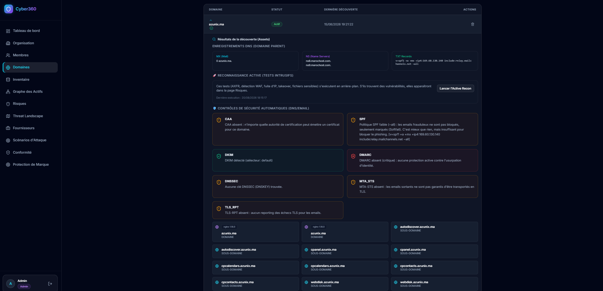

Chaque actif a une fiche (certificat TLS, technologies détectées, risques spécifiques, cycle de vie EOL), une **criticité métier ajustable** et un **rescan ciblé** pour valider un correctif sans relancer un scan complet.

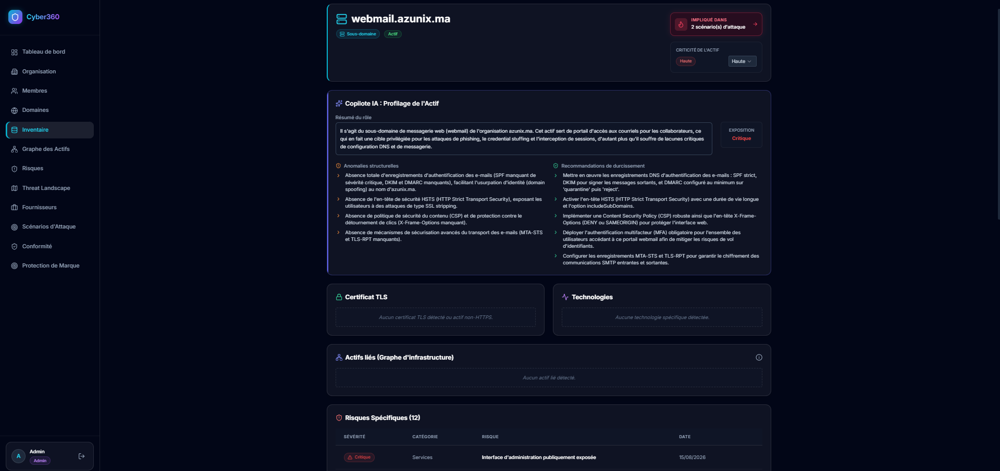

Le **graphe des actifs** relie les actifs entre eux (IP partagée, certificat TLS commun, chaîne CNAME, même ASN…) et met en évidence ceux qui sont ciblés par un scénario d'attaque.

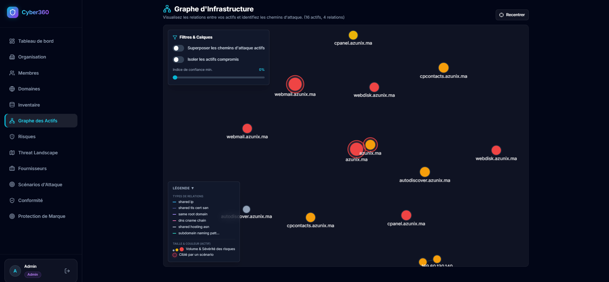

### ⚠️ Risques priorisés

Les résultats bruts des checks (`CheckResult`) sont qualifiés en **risques** (`Risk`) avec une sévérité (critique, important, moyen, faible), une catégorie (DNS, TLS, messagerie, services…), une preuve, une remédiation et une **estimation d'exposition financière indicative**. Résolution unitaire ou en masse, acceptation de risque (faux positif).

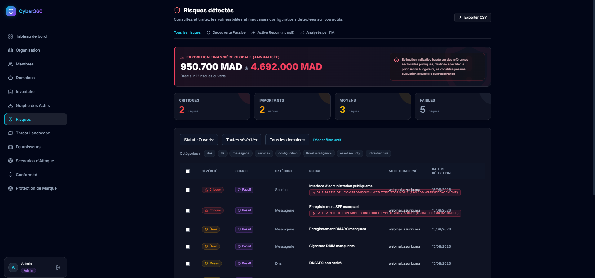

### 🧠 Scénarios d'attaque (Kill Chain)

Au lieu de lister des failles isolées, le moteur de scénarios les **chaîne** en chemins d'attaque ordonnés (point d'entrée → … → impact). Un scénario est **complet** (exploitable maintenant) ou **partiel** (une étape manque encore), et reçoit un score de **vraisemblance** et de **sévérité**. Des scénarios spécifiques au contexte marocain sont fournis (ex. spearphishing ciblé, compromission web de type STORMOUS).

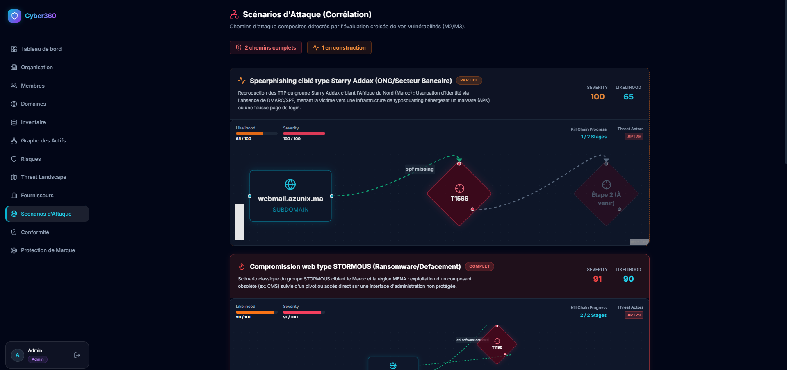

### 🗺️ Matrice MITRE ATT&CK

Matrice interactive des tactiques et techniques auxquelles l'organisation est exposée, avec vue « exposées uniquement », recherche, et tiroir de détail par technique : risques actifs liés, mitigations recommandées, groupes de menace connus pour l'utiliser.

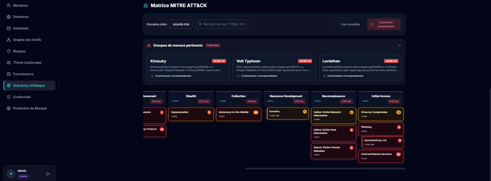

### 🌍 Threat Landscape

Vue des groupes de menace qui ciblent le secteur et la région de l'organisation (Lazarus, APT34/OilRig, MuddyWater…), corrélés avec ses vulnérabilités ouvertes : techniques communes, exposition, sévérité moyenne. Une synthèse quotidienne générée par IA résume les préoccupations majeures et les recommandations.

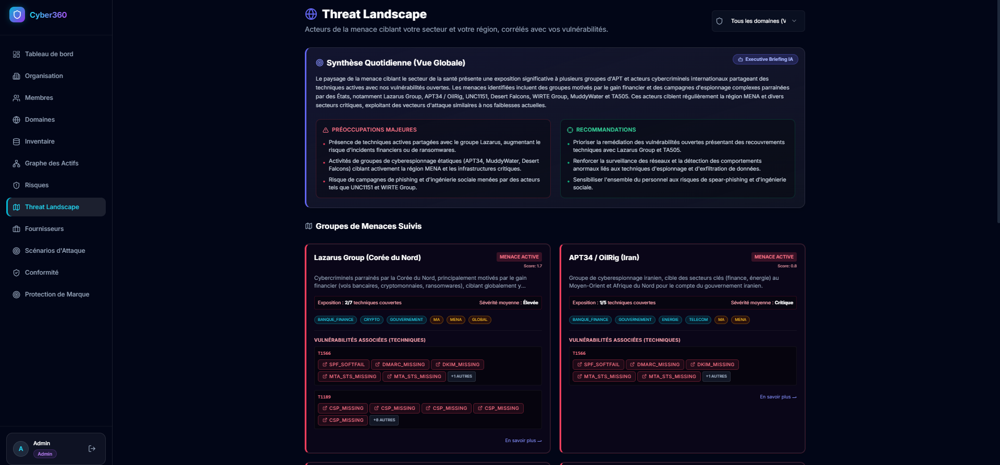

### ⚖️ Conformité réglementaire

Traduction automatique des risques techniques en contrôles réglementaires (**DNSSI**, **ISO 27001**, **Loi 09-08**), avec un score de conformité par référentiel. Statuts *Conforme*, *Non conforme* et *Non évaluable* : la plateforme assume explicitement ce qu'un scanner externe ne peut pas vérifier (politiques RH, procédures internes).

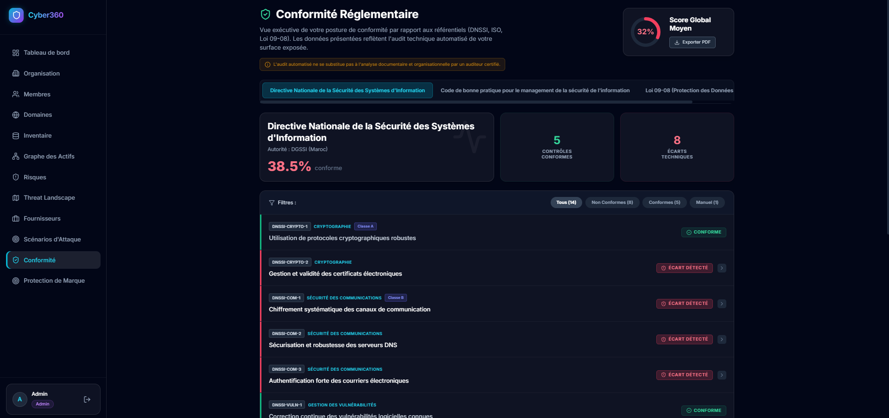

### 🎯 Protection de marque

Trois radars externes, exécutés en tâches planifiées (Celery Beat) ou lancés à la demande :

- **Typosquatting** : génération de permutations de domaine (`dnstwist`), résolution DNS, puis score de similarité HTML (Ratcliff/Obershelp) pour distinguer une simple page de parking d'un clone de phishing actif.
- **Fuites de données** : vérification Have I Been Pwned sur les domaines dont la propriété est prouvée.
- **Certificate Transparency** : alerte sur tout nouveau certificat émis pour la marque.

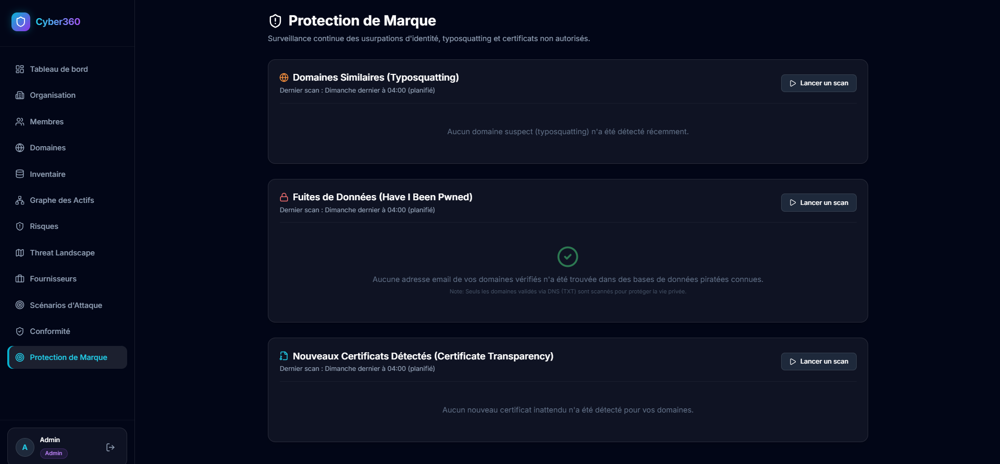

### 🤖 Copilote IA

Intégration de Google Gemini (Google GenAI SDK) pour générer des synthèses exécutives et proposer du code de remédiation, dans un cadre strictement contraint par les données de la plateforme. Pour chaque risque, le copilote explique la faille, son impact métier, les étapes de remédiation et suggère des techniques MITRE ATT&CK à confirmer par l'analyste.

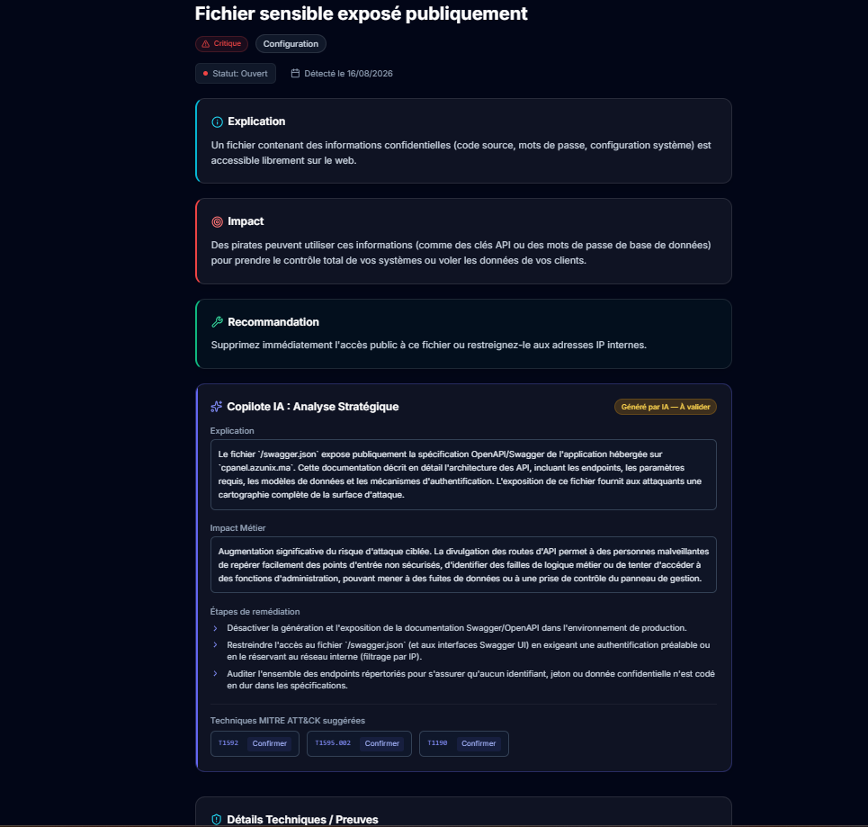

---

## 🏗️ Architecture

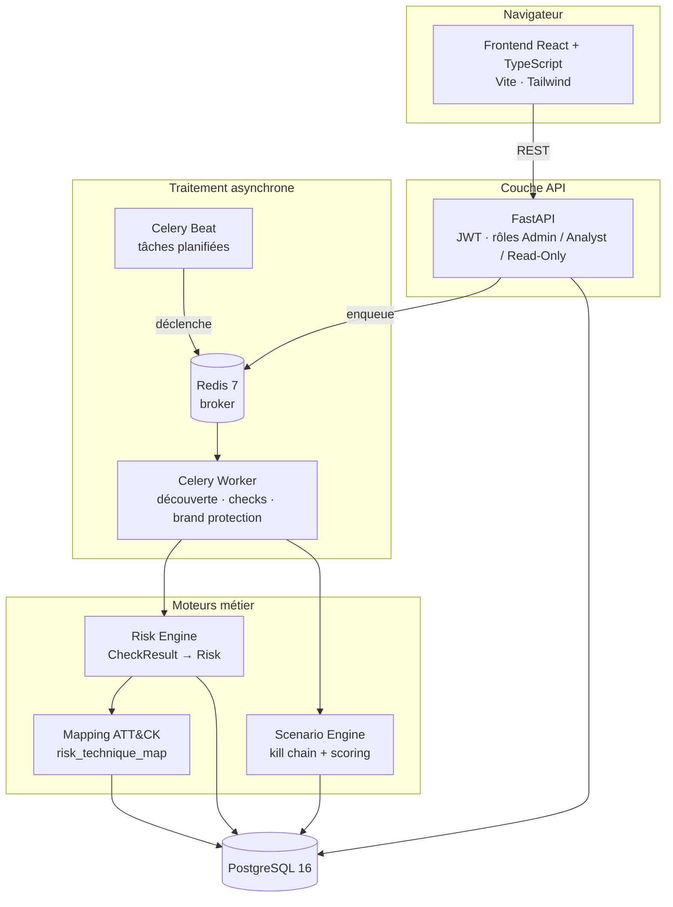

### Le pipeline en 4 étapes

| # | Étape | Ce qui se passe |
|---|---|---|
| 1 | **Découverte** | Les workers énumèrent les sous-domaines, résolvent les IP, récupèrent les certificats TLS et stockent les actifs (`Asset`) et leurs relations déduites (`AssetRelation`). |
| 2 | **Évaluation des risques** | Des dizaines de checks (messagerie, TLS, ports, en-têtes HTTP…) produisent des `CheckResult`, qualifiés ensuite en `Risk`. |
| 3 | **Corrélation** | Chaque risque est mappé sur MITRE ATT&CK, puis le Scenario Engine évalue les kill chains sur l'ensemble de l'organisation. |
| 4 | **Threat Intelligence** | Des tâches planifiées surveillent la marque (typosquatting, fuites, certificats) et alimentent la même table `Risk`. |

La séparation `CheckResult` / `Risk` est volontaire : on peut rejouer la logique de qualification (changement de seuils de sévérité) **sans re-scanner l'infrastructure**. Si un scan plante, seul le worker Celery est affecté : l'API et le frontend continuent de fonctionner.

---

## 🔬 Ce qui rend le moteur de corrélation différent

### 1. Mapping MITRE ATT&CK déclaratif et découplé

Aucune règle de correspondance n'est codée en dur dans Python (pas de cascade de `if/else`). La source de vérité est un **fichier déclaratif** ; la base de données en dérive.

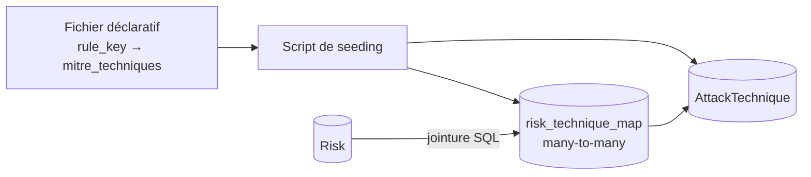

Exemple : `admin_port_exposed` → `T1133` (External Remote Services). Ajouter 50 règles de détection propres aux menaces marocaines ou migrer vers une nouvelle version d'ATT&CK ne demande **aucune modification du code du moteur** : il suffit de mettre à jour le fichier et de relancer le seeding.

### 2. Scénarios d'attaque sous forme de kill chain

Les scénarios sont définis dans `attack_scenarios.json`. Chaque scénario est une **suite ordonnée d'étapes** (tactiques ATT&CK) avec, par étape, des `rule_keys` à satisfaire et un paramètre `require_same_asset` (l'étape doit-elle rester sur le même actif ou peut-elle pivoter ?). Au niveau du scénario, `max_hops` et `allowed_relation_types` bornent les pivots autorisés.

- **Open** : toutes les étapes sont franchissables → chemin d'attaque complet.
- **Partial** : au moins une étape est franchissable, il en manque → scénario « en germe », utile en alerte préventive.
- **Resolved** : les conditions ne sont plus réunies après correction → auto-guérison, avec horodatage.

Le moteur charge **une seule fois** les risques et les arêtes du graphe en mémoire, sans requête SQL dans les boucles : la complexité reste en **O(N)** par rapport au nombre de risques.

### 3. Graphe de pivot *inféré*, pas une topologie réseau

Cyber360 fonctionne en boîte noire : il ne voit pas le trafic interne. Les relations entre actifs (`AssetRelation`) sont donc des **déductions probabilistes** à partir de signaux externes, chacune avec un score de confiance :

| Signal | Exemple | Confiance typique |
|---|---|---|
| `shared_tls_cert_san` | Un même certificat couvre deux noms | élevée |
| `dns_cname_chain` | Un CNAME pointe de l'un vers l'autre | élevée |
| `subdomain_naming_pattern` | `api.` et `api-internal.` | moyenne |
| `shared_ip` | Deux noms résolvent vers la même IP | faible (hébergement mutualisé possible) |
| `shared_hosting_asn` | Même hébergeur, IP différente | très faible |

Plusieurs signaux sur une même paire sont fusionnés par `1 − ∏(1 − cᵢ)`, ce qui ne dépasse jamais 1 et reflète le renforcement mutuel des indices.

### 4. Scoring

- **Sévérité** : moyenne pondérée de la sévérité des risques du chemin, avec un poids croissant vers la fin de la chaîne.
- **Vraisemblance** : complétude de la kill chain, confiance moyenne des arêtes de pivot, fraîcheur des risques et pertinence face aux groupes de menace connus pour cibler la région ou le secteur.

---

## 🧰 Stack technique

| Couche | Technologies |
|---|---|
| **Backend** | Python · FastAPI · SQLAlchemy (async, `asyncpg`) · Alembic |
| **Base de données** | PostgreSQL 16 |
| **Asynchrone** | Celery (worker + beat) · Redis 7 |
| **Frontend** | React 18 · TypeScript · Vite · Tailwind CSS |
| **Sécurité applicative** | JWT · rôles Admin / Analyst / Read-Only |
| **Threat Intelligence** | MITRE ATT&CK (STIX) · dnstwist · Have I Been Pwned · Certificate Transparency |
| **IA** | Google GenAI SDK (Gemini) |
| **Déploiement** | Docker · Docker Compose |

---

## 🚀 Démarrage rapide

### Prérequis

- [Docker](https://docs.docker.com/get-docker/) et Docker Compose
- Une clé API Gemini (pour le copilote IA uniquement ; le reste fonctionne sans)

### 1. Cloner le dépôt

```bash
git clone https://github.com/h-4mza/Plateforme-Cyber360-EASM-CTI-.git
cd Plateforme-Cyber360-EASM-CTI-
```

### 2. Configurer l'environnement

```bash
cp backend/.env.example backend/.env
# puis éditez backend/.env et renseignez GEMINI_API_KEY
```

### 3. Lancer toute la plateforme

```bash
docker compose up -d --build
```

Cette commande démarre PostgreSQL, Redis, l'API FastAPI (les migrations Alembic sont appliquées automatiquement au démarrage), le worker Celery, le scheduler Celery Beat et le frontend. Le premier build peut prendre quelques minutes.

> Si votre installation utilise l'ancienne syntaxe, remplacez `docker compose` par `docker-compose`.

### 4. Charger les données de Threat Intelligence

Le moteur a besoin du référentiel MITRE ATT&CK et des groupes de menace pour fonctionner :

```bash
docker exec -it cyber360-backend python scripts/run_sync_and_seed.py
```

Pour générer en plus des vulnérabilités de démonstration :

```bash
docker exec -it cyber360-backend python scripts/seed_attack_demo.py
```

### 5. Ouvrir la plateforme

| Service | URL |
|---|---|
| Interface web | <http://localhost:3000> |
| Documentation API (Swagger) | <http://localhost:8000/docs> |

### Premiers pas

1. Connectez-vous, puis allez dans **Domaines** et ajoutez un domaine racine (par exemple un domaine dont vous êtes propriétaire).
2. Ajoutez l'enregistrement **TXT** indiqué dans votre zone DNS, puis cliquez sur **Vérifier**.
3. Lancez la reconnaissance : les actifs apparaissent dans **Inventaire**, les failles dans **Risques**.
4. Consultez **Scénarios d'attaque** et la **Matrice MITRE ATT&CK** pour voir comment les failles se combinent.

### Commandes utiles

```bash
docker compose logs -f backend          # logs de l'API
docker compose logs -f celery-worker    # logs des scans
docker compose restart celery-worker celery-beat   # après modification du code des tâches
docker compose down                     # arrêter
docker compose down -v                  # arrêter et supprimer la base
```

> ⚠️ **Après toute modification du code des tâches Celery, redémarrez `celery-worker` et `celery-beat`.** Un worker garde l'ancien code en mémoire : une tâche ajoutée mais non rechargée ne s'exécutera jamais.

---

## ⚙️ Configuration

Variables définies dans `backend/.env` (voir `backend/.env.example`) :

| Variable | Rôle | Obligatoire |
|---|---|---|
| `GEMINI_API_KEY` | Clé Google Gemini pour le copilote IA | Pour le copilote uniquement |

Les variables `DATABASE_URL`, `DATABASE_URL_SYNC` et `REDIS_URL` sont injectées par `docker-compose.yml`.

| Service | Port hôte |
|---|---|
| Frontend | `3000` |
| API FastAPI | `8000` |
| PostgreSQL | `5432` |
| Redis | `6379` |

> 🔒 **Avant tout déploiement hors poste de développement** : le fichier `docker-compose.yml` utilise des identifiants PostgreSQL par défaut (`cyber360` / `cyber360`) et expose PostgreSQL et Redis sur la machine hôte. Changez les mots de passe, retirez les `ports` de ces deux services et passez le frontend en build de production.

---

## 🧪 Tests

```bash
docker exec -it cyber360-backend pytest
```

La suite couvre notamment l'agrégation de confiance des relations de pivot, le calcul des scores de sévérité et de vraisemblance, la transition d'un scénario de *partial* à *open* via un pivot, la non-régression du format de `attack_scenarios.json`, et le chaînage Celery entre la reconnaissance active et l'inférence du graphe d'actifs.

---

## 📂 Structure du dépôt

```text
.
├── backend/               API FastAPI, modèles SQLAlchemy, moteurs, tâches Celery, migrations Alembic
├── frontend/              Application React + TypeScript (Vite, Tailwind)
├── docs/
│   └── screenshots/       Captures utilisées dans ce README
├── docker-compose.yml     Orchestration : postgres, redis, backend, celery-worker, celery-beat, frontend
├── update_mitre.py        Mise à jour du référentiel MITRE ATT&CK
└── README.md
```

---

## 🧭 Limites connues et feuille de route

**Limites assumées**

- **Boîte noire par conception** : pas d'agent interne, donc pas de vraie topologie réseau. Les chemins de pivot sont des déductions probabilistes, signalées comme telles dans l'interface.
- **Conformité technique uniquement** : le tableau de bord ne remplace pas un audit réalisé par un auditeur agréé DGSSI ou un cabinet spécialisé.
- **Sources de Threat Intelligence** : les groupes de menace régionaux sont gérés via une table de pertinence ; l'intégration d'une instance MISP n'est pas encore branchée.

**Prochaines étapes**

- [ ] Alerting temps réel (email, webhook, WebSocket) sur passage d'un scénario en *open*
- [ ] Vue graphe d'infrastructure complète (force-directed) avec superposition des chemins d'attaque
- [ ] Connecteurs supplémentaires (Censys, Shodan avancé)
- [ ] Intégration MISP pour alimenter dynamiquement les groupes de menace
- [ ] Passage en build de production du frontend et durcissement du `docker-compose.yml`
- [ ] Scaling des workers Celery pour de très grands périmètres

---

## ⚖️ Cadre légal et déontologique

> **Avertissement.** Ce projet a été développé dans un cadre académique (Projet de Fin d'Études en ingénierie de cybersécurité).
>
> Les modules de **reconnaissance active** (scan de ports, énumération, détection de vulnérabilités) ne doivent **jamais** être exécutés sur une infrastructure tierce sans autorisation écrite explicite. La plateforme exige une **preuve de propriété par enregistrement DNS TXT** avant tout scan actif. Toute utilisation malveillante est strictement interdite.

---

<div align="center">

Développé par **[h-4mza](https://github.com/h-4mza)** · Cyber360, EASM & CTI pour le contexte marocain

</div>
